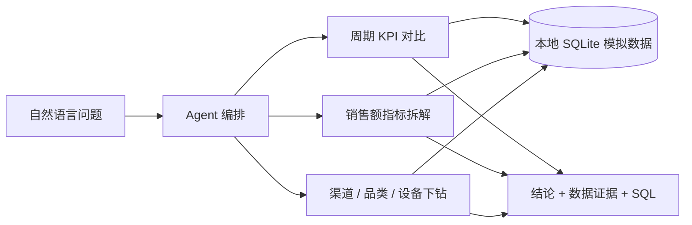

# 电商经营诊断 Agent

一个用于作品集展示的本地数据分析 Agent。用户用自然语言提出经营问题，Agent 查询电商指标、拆解销售额变化，并按渠道、品类或设备继续分析，最后给出带数据依据和 SQL 的诊断报告。

> 当前内置的是模拟数据，用来演示分析流程。它不代表任何真实商家的经营结果。

**English:** A local ecommerce analytics agent that investigates revenue changes with read-only KPI, metric decomposition, and dimension breakdown tools. It includes a deterministic demo mode and optional model-driven tool calling.

## Python 在项目中的作用

Python 是项目的后端和分析核心，代码集中在 `app.py`：

- 生成演示数据并存入 SQLite。
- 通过只读分析函数计算 KPI、销售额拆解和维度对比。
- 接收网页请求、编排 Agent 工具调用，并在配置 API Key 时请求模型。
- 启动本地 HTTP 服务，向浏览器提供页面与分析接口。

`index.html` 只负责页面展示和收集问题。请通过 `python app.py` 启动 Python 服务后使用网页；直接双击打开 HTML 文件会绕过 Python 后端，分析功能无法连接。

## 功能

- 比较最近 7 天和之前 7 天的销售额、订单、访问量、转化率与客单价。
- 将销售额变化顺序拆解为流量、转化率和客单价的影响。
- 按渠道、品类或设备比较两个周期，并展示 Agent 的工具调用与 SQL。
- 默认使用内置分析流程，无第三方 Python 依赖、无需 API Key。
- 可选连接 OpenAI 或兼容 Chat Completions 的模型 API，让模型根据问题选择只读分析工具。
- 应用在本地运行，API Key 只保存在 Python 服务端内存；启用模型模式时，问题和聚合结果会发送到所配置的模型服务。

## 界面预览

页面包括经营指标卡片、自然语言问题输入、工具调用记录和销售额拆解图。启动后可尝试：

- `上周销售额为什么下降？`
- `哪个渠道的流量变化最大？`
- `哪个品类贡献了最多销售额？`

## 快速开始

需要 Python 3.10 或更新版本。项目只使用 Python 标准库。启动后 Python 会自动打开浏览器；如需关闭自动打开，可设置 `OPEN_BROWSER=0`。

### Windows PowerShell

```powershell
python app.py
```

也可以运行 `start.ps1`。随后打开终端显示的地址，默认是 <http://127.0.0.1:8765>。按 `Ctrl+C` 停止服务。

### macOS / Linux

```bash
python3 app.py
```

如需更改端口，可启动前设置 `PORT` 环境变量。

## 启用模型 API（可选）

启动服务并打开页面后，点击右上方 **配置模型 API**，填写 API Key、模型名和 API Base URL，然后保存。Key 只保存在当前 Python 服务的内存中，关闭或重启服务后清除；不会写入项目文件或浏览器本地存储。

也可以在 PowerShell 启动前设置环境变量：

```powershell
$env:OPENAI_API_KEY = "你的 API Key"
$env:OPENAI_MODEL = "gpt-4.1-mini"
# 可选：兼容 OpenAI Chat Completions 的服务地址
# $env:OPENAI_BASE_URL = "https://api.openai.com/v1"
python app.py
```

不要把真实 API Key 写进代码、README 或提交到 GitHub。页面配置支持 HTTPS 地址；本地兼容服务可以使用 localhost HTTP 地址。模型通过 function calling 请求应用提供的分析函数；Python 应用执行只读聚合并将结果交回模型生成解释。问题与聚合结果会发送到配置的 API 服务。实现流程参考 [OpenAI Function Calling 文档](https://developers.openai.com/api/docs/guides/function-calling)。

## 分析与数据口径

- 每次启动都会在内存 SQLite 中生成 90 天模拟数据，包含日期、渠道、品类、设备、访问量、订单和销售额。
- 最后 7 天预置了付费社媒流量下降的演示情景。
- 销售额按 `访问量 × 转化率 × 客单价` 顺序拆解。拆解贡献会受顺序影响，应作为诊断线索，不应当成严格的因果估计。
- 内置流程会根据问题选择渠道流量分析、品类比较或销售额诊断；模型模式可自行选择可用的只读工具。
- 连接真实数据前，应先定义指标口径，并确认数据权限、脱敏和质量。

## 工作流程



## 文件结构

```text
app.py       Python 后端、本地 HTTP 服务、模拟数据、分析工具和模型工具调用循环
index.html   中文分析页面
start.ps1    Windows PowerShell 启动脚本
.gitignore   忽略本地密钥、缓存和临时文件
README.md    项目介绍、运行方式和数据口径
```

## 上传到 GitHub

1. 在 GitHub 新建一个空仓库，例如 `ecommerce-diagnostic-agent`。创建时可以先不添加 README、License 或 `.gitignore`。
2. 在本项目目录中运行以下命令，将 `<你的用户名>` 替换成 GitHub 用户名：

```bash
git init -b main
git add .
git commit -m "Build ecommerce diagnostic agent"
git remote add origin https://github.com/<你的用户名>/ecommerce-diagnostic-agent.git
git push -u origin main
```

本仓库未包含开源许可证；如果希望其他人可以复用或修改代码，创建仓库时选择合适的 License。

## 后续可扩展

1. 导入公开 CSV/Parquet 数据，并增加上传界面。
2. 加入指标字典和数据质量检查，减少口径不一致造成的错误解释。
3. 建立带标准答案的评估案例，记录指标计算正确率、下钻命中率和结论可追溯率。
4. 增加日期范围选择和 Markdown/HTML 报告导出。

